# Database design

MySQL 8.x, InnoDB, `utf8mb4`. Source of truth: [`database/schema.sql`](../database/schema.sql) and
[`database/seed.sql`](../database/seed.sql). The ER diagram is below (Mermaid renders on GitHub and in VS Code with a Mermaid extension).

## ER diagram

```mermaid
erDiagram
    REGIONS ||--o{ LOCATIONS : "contains"
    LOCATIONS |o--o{ CHARACTERS : "home of"
    CHARACTERS ||--o{ CHARACTER_RELATIONSHIPS : "from"
    CHARACTERS ||--o{ CHARACTER_RELATIONSHIPS : "to"
    VEHICLE_CATEGORIES ||--o{ VEHICLES : "groups"
    MISSIONS ||--o{ MISSION_CHARACTERS : "features"
    CHARACTERS ||--o{ MISSION_CHARACTERS : "appears in"
    MISSIONS ||--o{ MISSION_VEHICLES : "uses"
    VEHICLES ||--o{ MISSION_VEHICLES : "used in"
    MISSIONS ||--o{ MISSION_LOCATIONS : "takes place at"
    LOCATIONS ||--o{ MISSION_LOCATIONS : "hosts"
    USERS ||--o{ FAVOURITE_CHARACTERS : "saves"
    CHARACTERS ||--o{ FAVOURITE_CHARACTERS : "saved as"
    USERS ||--o{ FAVOURITE_VEHICLES : "saves"
    VEHICLES ||--o{ FAVOURITE_VEHICLES : "saved as"
    USERS ||--o{ FAVOURITE_MISSIONS : "saves"
    MISSIONS ||--o{ FAVOURITE_MISSIONS : "saved as"
    USERS ||--o{ FAVOURITE_LOCATIONS : "saves"
    LOCATIONS ||--o{ FAVOURITE_LOCATIONS : "saved as"
    MEDIA_ASSETS ||--o{ MEDIA_CHARACTERS : "shows"
    CHARACTERS ||--o{ MEDIA_CHARACTERS : "shown in"
    MEDIA_ASSETS ||--o{ MEDIA_LOCATIONS : "shows"
    LOCATIONS ||--o{ MEDIA_LOCATIONS : "shown in"

    USERS { int user_id PK
            varchar username UK
            varchar email UK
            varchar password_hash
            enum role }
    REGIONS { smallint region_id PK
              varchar slug UK
              varchar name UK
              enum content_status
              varchar source_url }
    LOCATIONS { int location_id PK
                smallint region_id FK
                varchar slug UK
                varchar name
                enum location_type
                enum content_status }
    CHARACTERS { int character_id PK
                 varchar slug UK
                 varchar full_name
                 int home_location_id FK
                 enum content_status
                 varchar source_url }
    CHARACTER_RELATIONSHIPS { int from_character_id PK_FK
                              int to_character_id PK_FK
                              enum relationship_type }
    VEHICLE_CATEGORIES { tinyint category_id PK
                         varchar slug UK
                         varchar name UK }
    VEHICLES { int vehicle_id PK
               tinyint category_id FK
               varchar slug UK
               varchar name UK
               enum content_status }
    MISSIONS { int mission_id PK
               varchar slug UK
               varchar title UK
               enum mission_type
               enum content_status }
    MISSION_CHARACTERS { int mission_id PK_FK
                         int character_id PK_FK
                         varchar role_in_mission }
    MISSION_VEHICLES { int mission_id PK_FK
                       int vehicle_id PK_FK
                       varchar usage_note }
    MISSION_LOCATIONS { int mission_id PK_FK
                        int location_id PK_FK
                        boolean is_primary }
    FAVOURITE_CHARACTERS { int user_id PK_FK
                           int character_id PK_FK }
    FAVOURITE_VEHICLES { int user_id PK_FK
                         int vehicle_id PK_FK }
    FAVOURITE_MISSIONS { int user_id PK_FK
                         int mission_id PK_FK }
    FAVOURITE_LOCATIONS { int user_id PK_FK
                          int location_id PK_FK }
    MEDIA_ASSETS { int media_id PK
                   varchar slug UK
                   enum media_type
                   enum usage_status
                   enum approval_status }
    MEDIA_CHARACTERS { int media_id PK_FK
                       int character_id PK_FK }
    MEDIA_LOCATIONS { int media_id PK_FK
                      int location_id PK_FK }
```



## Tables and why each exists (18)

| # | Table | Why it exists | Key points |
|---|-------|---------------|-----------|
| 1 | `users` | Accounts for favourites and admin access (Phase 3). | PK `user_id`. `username` and `email` UNIQUE. `role` is `user` or `admin`. Stores only a password **hash**. |
| 2 | `regions` | Large areas of Leonida. | UNIQUE `slug`, `name`. |
| 3 | `locations` | Places inside a region. | FK `region_id` (RESTRICT). UNIQUE `(region_id, name)`. |
| 4 | `characters` | People in the world. | Optional FK `home_location_id` (ON DELETE SET NULL). |
| 5 | `character_relationships` | Many-to-many **between characters** (partner, ally, rival ...). | Composite PK `(from, to)`, `CHECK from <> to`, both FKs ON DELETE CASCADE. |
| 6 | `vehicle_categories` | Lookup table so a category name is stored once (3NF) and can be grouped/counted. | UNIQUE `slug`, `name`. |
| 7 | `vehicles` | Vehicle catalogue. | FK `category_id` (RESTRICT). No performance stats, because none are confirmed. |
| 8 | `missions` | Mission and story records. | `mission_type` enum. |
| 9 | `mission_characters` | Many-to-many mission <-> character. | Composite PK, plus `role_in_mission` (data that belongs to the *pair*). |
| 10 | `mission_vehicles` | Many-to-many mission <-> vehicle. | Composite PK, plus `usage_note`. |
| 11 | `mission_locations` | Many-to-many mission <-> location. | Composite PK, plus `is_primary`. |
| 12-15 | `favourite_characters`, `favourite_vehicles`, `favourite_missions`, `favourite_locations` | A user's saved records. | Composite PK `(user_id, entity_id)` makes a duplicate favourite impossible. Both FKs CASCADE. |
| 16 | `media_assets` | Database half of the media inventory. Records where an asset lives and its permission state. Never contains copied Rockstar media. | `usage_status`, `approval_status`, `CHECK` that some location (link/embed/local path) exists. |
| 17 | `media_characters` | Many-to-many media <-> character. | Composite PK. |
| 18 | `media_locations` | Many-to-many media <-> location. | Composite PK. |

### Decision: four favourite tables instead of one "polymorphic" table
A single `favourites(user_id, entity_type, entity_id)` table cannot have a real foreign key, so MySQL could not stop a
favourite pointing at a deleted or non-existent record. Four small tables keep full referential integrity,
and the SQL stays simple to explain.

### Decision: `content_status` on every core table
`official` (confirmed by Rockstar, **`source_url` required by a CHECK constraint**), `fan` (community interpretation)
or `demo` (fictional record by Team Valkyrie). This makes the "never mislead visitors" rule something the database
enforces, not just a convention.

## Relationship types demonstrated

* **One-to-many:** regions -> locations, vehicle_categories -> vehicles, locations -> characters (home).
* **Many-to-many:** characters <-> characters, missions <-> characters / vehicles / locations, users <-> each entity (favourites), media <-> characters / locations.
* **Composite primary keys:** 10 tables (`character_relationships`, 3 mission junctions, 4 favourites, 2 media junctions).
* **Cascade rules:** deleting a character removes its junction rows (CASCADE) but only blanks `home_location_id` on
  characters when a location is deleted (SET NULL). Deleting a region or category that is still in use is **blocked** (RESTRICT).

## Normalization (3NF)

* Every table has a primary key and atomic columns (no comma-separated lists).
* Attributes depend on the whole key: `role_in_mission` depends on the *pair* (mission, character), so it lives on the junction table.
* No transitive dependencies: a vehicle stores `category_id`, not the category name and description. A location stores `region_id`, not the region name.
* Deliberate, documented trade-off: `source_url` / `source_note` repeat per row. They are facts about *that record's provenance*, not about a shared entity.

## Indexes

Primary and unique keys create indexes automatically. Additional ones: `ix_characters_full_name`
(sorting), `ix_characters_status`, `ix_missions_type`, `ix_media_assets_type`, and a reverse-lookup index on the second column of every junction
table (so "which missions feature this character?" does not scan the table). Foreign-key columns are always indexed.
Search currently uses `LIKE '%text%'`, which cannot use a normal index. That is acceptable at this data size and FULLTEXT is a Phase 4 option.

## Transactions

* `scripts/init_db.py` loads the seed inside one transaction (all-or-nothing).
* `app/db.py` provides `transaction()` for multi-table writes (admin relationship editing in Phase 3). `tests/test_db_connection.py` proves it commits on success and rolls back on error.

## Seed data honesty

| Entity | Seeded | Status |
|--------|--------|--------|
| Characters | Jason Duval, Lucia Caminos, Cal Hampton, Boobie Ike, Dre'Quan Priest, Raul Bautista, Brian Heder, Real Dimez (8) | `official`: all eight are listed on https://www.rockstargames.com/VI/only-in-leonida (checked 2026-10-09). Descriptions are our own short paraphrases |
| Characters | 3 fictional characters | `demo` |
| Regions | Vice City, Leonida Keys, Grassrivers, Port Gellhorn, Ambrosia, Mount Kalaga (6) | `official`: all six are listed on the same Rockstar page. We store only what it states |
| Locations, vehicles, missions | all | `demo` |
| Relationships | Jason-Lucia, Brian-Jason, Cal-Jason, Boobie Ike-Dre'Quan | `official` (stated on that page). The other three are `demo` |
| Media | 3 link-only rows pointing at the official `/VI/trailer-1`, `/VI/trailer-2`, `/VI/media` pages | `pending_review` (no embed or licence terms confirmed) |

**Correction history:** the first Phase 1 seed marked five regions as `fan` and omitted Real Dimez because only secondary sources had been reachable. A direct check of Rockstar's Leonida page confirmed them, so they were reclassified.

Demo missions deliberately contain **only demo characters**, so the project never invents story for real GTA VI characters.

## Accounts and privileges

| Account | Used by | Privileges (project databases only) |
|---------|---------|-------------------------------------|
| `valkyrie_app` | the running website and the test suite's queries | `SELECT, INSERT, UPDATE, DELETE` |
| `valkyrie_migrator` | `scripts.setup_db` / `scripts.init_db` (schema load) | the above plus `CREATE, DROP, ALTER, INDEX, REFERENCES` |
| MySQL admin (root) | `scripts.setup_db` only, via a hidden prompt, once | not stored anywhere |

`tests/test_privileges.py` proves the website account is refused `DROP`, `CREATE`, `ALTER`, `TRUNCATE`, `CREATE USER`, `DROP DATABASE` and reading `mysql.user`, and that the migration account cannot create databases or users.
`REFERENCES` is required by MySQL to create foreign keys (discovered by testing: the load fails without it).

## Reproducible setup

```powershell
python -m scripts.make_env              # local .env with random secrets
python -m scripts.setup_db --plan       # read-only preview
python -m scripts.setup_db              # apply (type YES). Never drops existing tables
python -m scripts.setup_db --reset      # also rebuild existing project tables (type RESET)
python -m scripts.init_db --reset       # rebuild only the development tables
```

Example queries (all executed by the test suite): [`queries.sql`](queries.sql).

## Known verification gap

Tested on **MySQL 8.0.46**. The project specifies 8.4 LTS. The schema uses only features present in both,
but it has **not** been run on 8.4. MySQL reports foreign-key failures as error 1451/1452 on some builds and 1216/1217 on
others, so tests accept either pair.
